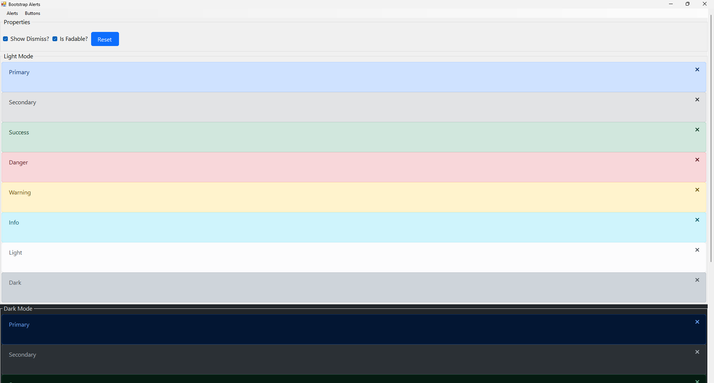
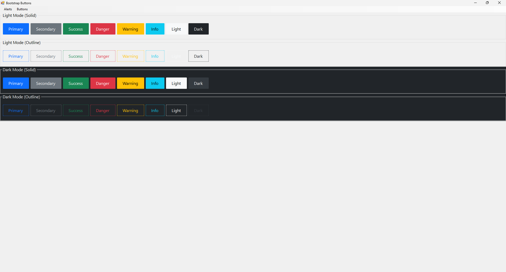

# Bootstrap Theme for .NET WinForms
**win-forms-bootstrap** is a Bootstrap 5–inspired control suite for .NET Windows Forms applications.

This project reimagines native WinForms controls using the visual language, spacing, typography, and color system of Bootstrap 5 - while remaining fully native to WinForms.

> NOTICE: This is a complete rewrite of the previous Bootstrap 4-based version.

## What's New in This Version

- Upgraded design system from Bootstrap 4 to Bootstrap 5
- Fully modular file structure (no more single-file library)
- Component-based architecture
- Light and Dark theme support
- Dedicated Utilities layer (Colors + Typography)
- Included Demo project

## Project Structure

The library is now organized by responsibility and component type:

```
win-forms-bootstrap
├── WinFormsBootstrap
│   ├── Components
│   │   ├── Alert
│   │   │   ├── Alert.vb
│   │   │   ├── AlertTheme.vb
│   │   │   ├── AlertTypes.vb
│   │   │   ├── LightTheme.vb
│   │   │   └── DarkTheme.vb
│   │   └── Button
│   │       ├── Button.vb
│   │       ├── ButtonTheme.vb
│   │       ├── ButtonTypes.vb
│   │       ├── LightTheme.vb
│   │       └── DarkTheme.vb
│   │
│   ├── Utilities
│   │   ├── Colors
│   │   │   ├── ColorUtility.vb
│   │   │   ├── ColorTypes.vb
│   │   │   ├── LightTheme.vb
│   │   │   └── DarkTheme.vb
│   │   └── Typography
│   │       ├── BaseFont.vb
│   │       ├── SansSerifFont.vb
│   │       ├── MonospaceFont.vb
│   │       └── TypographyUtility.vb
│   │
│   ├── WinFormUtility.vb
│   └── WinFormsBootstrap.vbproj
│
├── WinFormsBootstrap.Demo
│   ├── FormAlerts.vb
│   ├── FormButtons.vb
│   └── Controls
│       └── GlobalNavigation.vb
│
└── WinFormsBootstrap.slnx
```

## Architecture Overview

The rewrite introduces a clean separation of concerns:

### Components

Each UI component contains:

- Core control implementation
- Type definitions (e.g., Primary, Secondary, Success)
- Theme abstraction
- Light & Dark implementations

This makes extending or adding new components straightforward.

### Utilities

- Colors: Implements Bootstrap 5 color tokens and theme-aware color logic.
- Typography: Implements Bootstrap-inspired font families and sizing helpers.

## Getting Started

### Option 1 – Add the Project Reference

1. Open WinFormsBootstrap.slnx
2. Build the WinFormsBootstrap.vb project
    1. Build > Build WinFormsBootstrap
    2. -or- Ctrl + B
3. Open your project's solution
4. Add a new reference
    1. Project > Add Reference
    2. Browse
    3. Select WinFormsBootstrap.dll from the WinFormsBootstrap's bin directory

### Option 2 – Copy the Library Project

You can copy the WinFormsBootstrap project directly into your solution and reference it.

## Theming

Each component supports:

- `LightTheme`
- `DarkTheme`

Themes are applied per component, allowing:

- Global theme control
- Mixed-theme UI
- Future custom theme extensions

## Demo Project

The solution includes a WinFormsBootstrap.Demo project demonstrating:

- Alerts
- Buttons
- Light/Dark variations

Use this project as a reference implementation.

## Migration from Bootstrap 4 Version

If you're upgrading from the original version:

| Old Version           | New Version                  |
| --------------------- | ---------------------------- |
| Single .vb file       | Fully modular project        |
| Bootstrap 4 styling   | Bootstrap 5 styling          |
| Limited extensibility | Component-based architecture |
| No theme abstraction  | Light/Dark theme support     |

Because this was a full rewrite, migration is not drop-in compatible.

## Under Development

This project is actively evolving. While stable for use, APIs may expand as new components are added.

Contributions, feature requests, and feedback are welcome.

## Screenshots

### Alerts



### Buttons



## ❤️ Support

This project is free and open source.

Show your support! Your (non-tax deductible) donation of Monero cryptocurrency is a sign of solidarity among web developers.

Being self-taught, I have come a long way over the years. I certainly do not intend on making a living from this free feature, but my hope is to earn a few dollars to validate all of my hard work.

Monero Address: 447SPi8XcexZnF7kYGDboKB6mghWQzRfyScCgDP2r4f2JJTfLGeVcFpKEBT9jazYuW2YG4qn51oLwXpQJ3oEXkeXUsd6TCF

